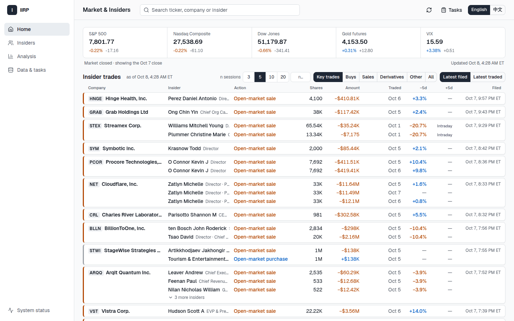
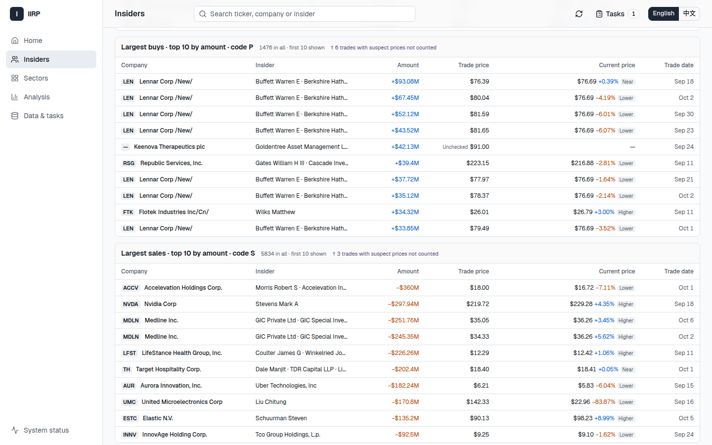
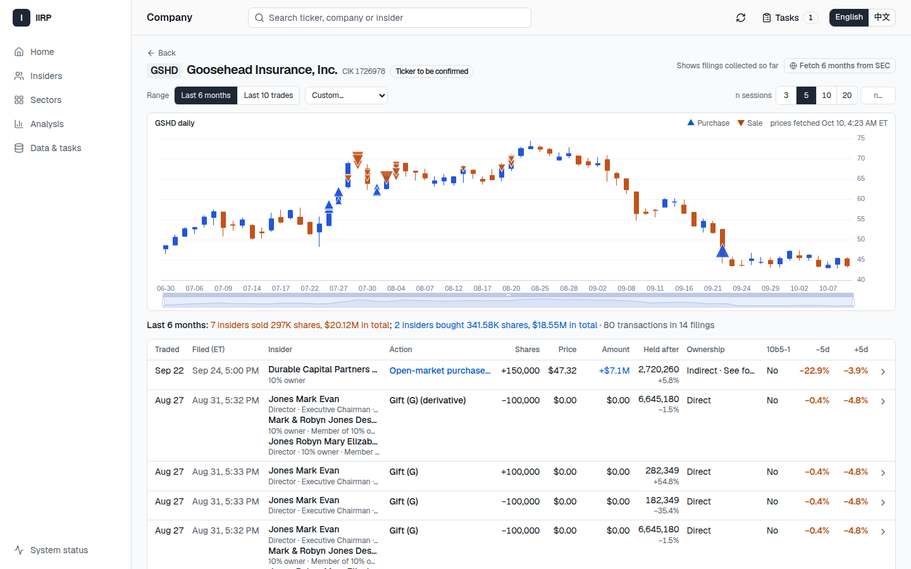
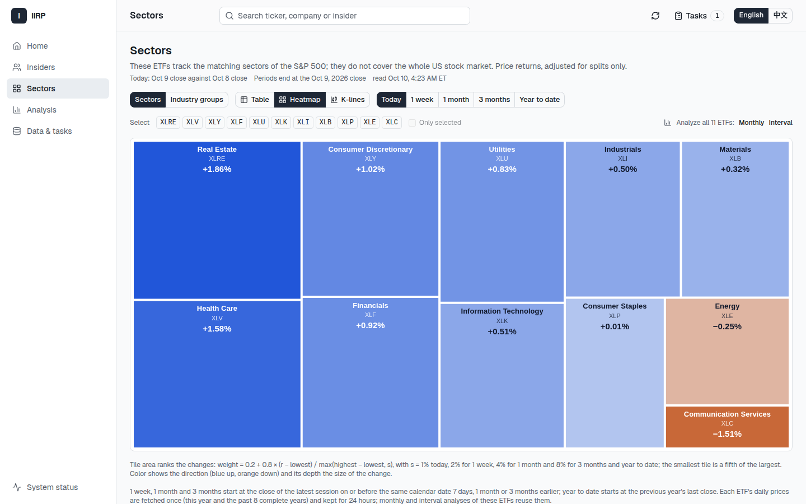
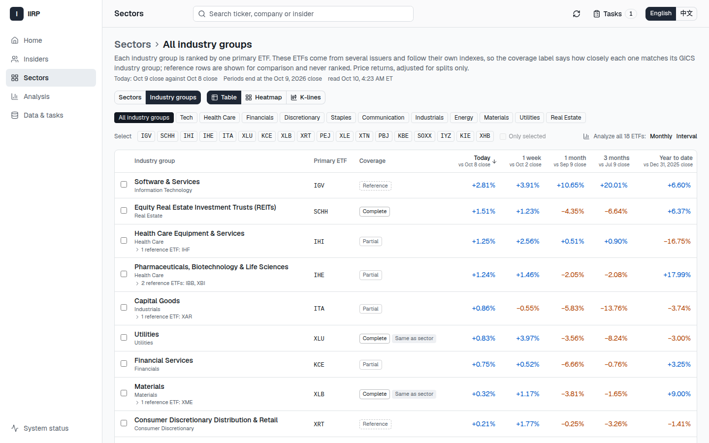
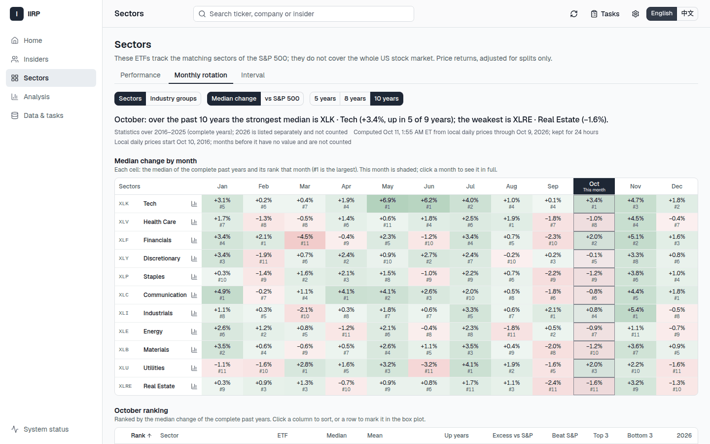
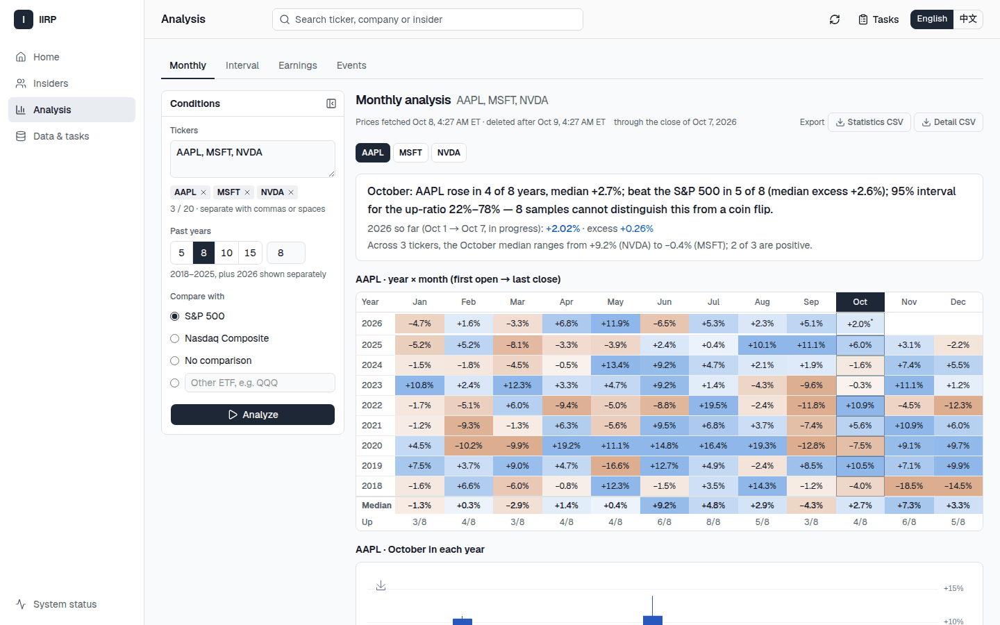
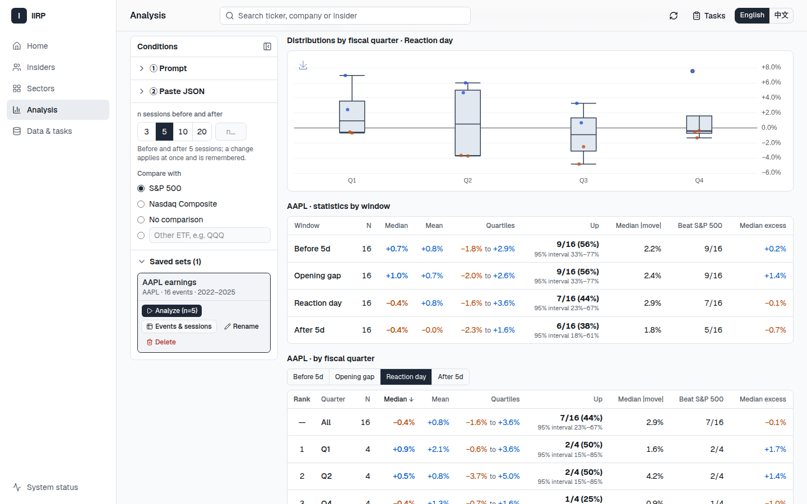
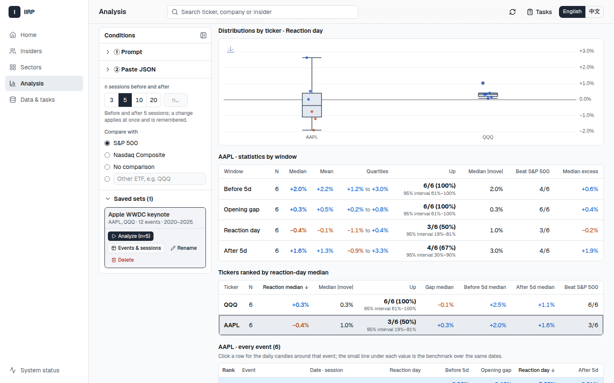

# IIRP

**English** · [中文](README.zh-CN.md)

IIRP is a personal research tool for US stocks that runs on your own computer. It
collects SEC insider-trading filings and daily prices, and shows them so you can do
your own research:

- **Insider trades**: a live feed of Form 3/4/5 filings as SEC publishes them, an
  overview of recent open-market buying and selling, and a lookup by ticker or name
  (last 6 months or last 10 trades by default), with the price change in the trading
  days before and after each trade.
- **Sectors**: the 11 S&P 500 sectors through their SPDR ETFs and their 25 industry
  groups through one ETF each, today and over 1 week, 1 month, 3 months and year to
  date, as a table, a heatmap or stacked candles; and their monthly rotation over the
  past ten years: which sectors tend to lead or lag in each month.
- **Price studies**: monthly seasonality, any date range across years, and price
  reactions to earnings or to any event you name.

It does not rate trades, give signals or give investment advice. Data and settings
stay on your machine.



## Quick start

You need [Docker](https://docs.docker.com/get-docker/) (Docker Engine with Compose v2
on Linux, Docker Desktop on macOS), Python 3 (only the standard library is used) and
git. On Windows, use WSL2 and keep the folder inside the Linux file system (for
example under `~`, not `/mnt/c`).

```bash
git clone https://github.com/565740807/IIRP.git iirp
cd iirp
./iirp start
```

The first run builds the image (a few minutes), creates `deploy/.env` from
`deploy/.env.example` (readable only by you, with a random database password), and
starts PostgreSQL, the web server and the background worker. Then open
<http://127.0.0.1:18081>.

**Add your SEC contact.** SEC asks automated tools to identify themselves with a name
and a real e-mail address. Until you add one, a notice at the top of the home page
says so and nothing is requested from SEC. Click **Add SEC contact**, enter your name
and e-mail, and insider filings start updating within a minute. It is stored only in
the local database and sent only to SEC. (You can instead set `IIRP_SEC_USER_AGENT`
in `deploy/.env`, for example `Jane Doe jane.doe@your-mail.com`; that value wins and
the page then shows it as set in the config file.)

What happens next: the worker follows new SEC filings (every minute or two on trading
days) and backfills the last 6 months of Form 3/4/5 filings, about 75,000 filings and
3 GB, which takes roughly a day at the polite rate IIRP uses (at most 2 requests per
second). Home-page market quotes refresh while the page is open, in one row: S&P
500, Nasdaq 100, Dow Jones, Russell 2000, VIX, the 10-year Treasury yield (in % with
changes in basis points), gold and WTI crude. The Nasdaq Composite, the US Dollar Index,
S&P 500 and Nasdaq 100 futures (shown outside US stock hours, only while they trade)
and bitcoin can be added. Choose
them under the gear icon at the top right. You can switch each automatic update off
under **Data & tasks → Automatic updates**.

Everyday commands:

```bash
./iirp status    # what is running
./iirp stop      # stop; data is kept in Docker volumes
./iirp start     # start again (also after git pull, to upgrade)
./iirp backup    # consistent backup of the database and saved filings
```

The page listens on `127.0.0.1:18081` only. To use another port, set
`IIRP_HTTP_PORT` in `deploy/.env`. The interface is in English; switch to Chinese at
the top right.

## Using IIRP

### Insider trades



- **Home**: new filings slide in at the top. Each card is one company on one filing
  day; each row is one insider: role, what they did (in SEC's wording), shares, value,
  trade price, the current price compared with it, trade date, and the price change n
  trading days before and after. Buys carry `+` and sales `−`; colors follow your
  settings (gear icon at the top right), green up and red down by default. If you
  scroll down, the list stays put and a "↑ N new trades" button appears instead.
- **Insiders**: the page opens with an overview of recent open-market trades (last 30
  days by default): several insiders buying or selling within a few days, the largest
  buys and sales, executive buys, large holdings increases and totals by company, each
  with the current price next to the trade price. Search a ticker or a person's name.
  If IIRP has not seen it yet, it asks SEC and downloads only that company's or
  person's filings in range. The default range is the last 6 months; switch to the
  last 10 trades or a custom range.
- **Company and person pages** show daily candles with insider buys (▲) and sales (▼)
  marked, a trade table, and the price change n trading days before and after each
  trade (n = 3, 5, 10, 20 or your own; default 5). Each trade links to its detail page
  and to the original SEC filing. A company page names its sector and sector ETF (and
  its GICS industry group with that group's ETF, when there is one): from the S&P 500
  list's GICS classification, else from Yahoo's sector, else none, with the source.
- **Index marks**: companies on the S&P 500 or Nasdaq-100 list carry a small SPX or NDX
  mark in the feed, the overview, search results and on their page. The lists are
  unofficial weekly copies (the S&P 500 list from GitHub datasets, the Nasdaq-100
  table from Wikipedia), updated every Saturday at 08:00 ET or on demand under
  **Data & tasks → Index lists**; a failed update keeps the previous list.
- **Price check**: each reported price is compared with the close on the trade day (or
  the latest quote). A price about 10× or more away from it, usually a filing error, is
  still shown as filed but marked and left out of the overview's amounts, rankings and
  totals; a price with nothing to compare against yet is marked unchecked.



### Sectors

The home page shows the 11 S&P 500 sectors under the market strip in one row, ranked
1–11 by today's change from left to right.
**Sectors** lists them through their SPDR ETFs (XLK, XLV, XLF, XLY, XLP, XLC, XLI, XLE,
XLB, XLU, XLRE; mapping in `config/sector-map.toml`) for today, 1 week, 1 month,
3 months and year to date, each with the close it compares against. Switch between a
sortable table, a heatmap and daily/weekly/monthly candles on one shared range; select
sectors and open them in the monthly or interval analysis. The ETFs cover the S&P 500
sectors, not the whole US market.



Click a sector, or switch the level to **Industry groups**, to see its GICS industry
groups (or all 25 together). Each group is ranked by one primary ETF and labelled
with how well that ETF covers it: complete, partial, reference, or pending when no
suitable ETF exists (listed last, never ranked). Related ETFs open as reference
rows under their group and are not ranked. Group ETFs are fetched only when you open
this level; the page shows each ETF's progress, and ETFs from both levels can be
selected together for an analysis (up to 20).



**Monthly rotation** asks whether a sector tends to lead or lag in a given month. For
every month it shows each sector's median change over the past complete years (10 by
default, or 5 or 8; this year is listed separately) and its rank among the sectors,
with this month highlighted. The chosen month opens in full: a sortable ranking with
the median, mean, up years and their 95% interval, the median excess over the S&P 500
and the years ahead of it, and how many years the sector finished in the top three and
the bottom three; a box plot per sector; and, year by year, each month's first and last
sector, so the actual order of rotation can be read along a row. Rank by the median
change or by the excess over the S&P 500, and switch to the industry groups that have
a primary ETF. **Interval** ranks the sectors the same way over any start and end
day, across the year end if needed. A sector with fewer years (XLC from 2018) is
counted over the years it has, and each year ranks only the sectors with a value that
year. Everything is computed from the local long-term daily prices; nothing is fetched,
and results are recomputed after 24 hours. Any sector opens in the monthly analysis
in one click.



### Analysis center



- **Monthly**: for up to 20 tickers over the last n years (default 10 plus this year),
  each month's return from the first trading day's open to the last trading day's
  close. You get a year × month heat map, box plots of each month across the years,
  one candle per year, and per month the median, the share of up years with a 95%
  interval, and how often it beat the benchmark (S&P 500 by default).
- **Interval**: the same for any date range, for example Dec 15 → Jan 10, including
  ranges that cross the new year.
- **Earnings** and **Events**: IIRP does not guess dates. It gives you a prompt, you
  ask an AI assistant that can search the web, and you paste back a JSON list:

  1. Enter tickers (and, for events, a description such as "Apple WWDC keynote"),
     choose the background window (default 30 days before to 14 days after; also
     1 week either side, or 3 months before to 1 month after), then **Copy prompt**.
     The prompt templates can be edited and reset; when the built-in template is
     newer than yours, the page says so.
  2. Paste the prompt into the AI assistant. It works in two steps: first it lists
     what it understood (tickers, dates, names, session, fiscal year and quarter)
     and asks about anything unclear, without any JSON; after you answer and
     confirm, it returns the JSON. It is told to leave out anything it cannot cite.
  3. Paste the JSON into IIRP. It is checked as you paste: errors are listed by
     item and field, and warnings (context outside the window, more than 8 context
     items, a missing source or link, entries the AI marked `uncertain`) do not
     block saving. Uncertain entries are highlighted in the preview. Click
     **Save and analyze**; each analysis keeps a frozen copy of the list.

  ```json
  {"events": [
    {"ticker": "AAPL", "date": "2025-10-30", "session": "after_close",
     "name": "FY2025 Q4 earnings", "fiscal_year": 2025, "fiscal_quarter": 4,
     "earnings": {"eps_actual": 1.85, "eps_estimate": 1.77,
                  "revenue_actual": 102466, "revenue_estimate": 102227},
     "context": [
       {"date": "2025-10-29", "category": "macro", "title": "Fed cuts rates by 25 bp",
        "summary": "The FOMC lowered the federal funds target range.",
        "source": "Federal Reserve", "url": "https://www.federalreserve.gov/",
        "major": true}
     ]},
    {"ticker": "AAPL", "date": "2025-06-09", "session": "during",
     "name": "WWDC 2025 keynote", "uncertain": true, "note": "Time not confirmed"}
  ]}
  ```

  Only `ticker`, `date`, `session`, `name` (and, for earnings, `fiscal_year` and
  `fiscal_quarter`) are required; lists without the other fields still work.
  `session` is `before_open`, `during`, `after_close` or `unknown`. `earnings`
  (all optional) holds EPS in USD per share, revenue in USD millions and
  `guidance` (`raised`, `maintained`, `lowered` or `none`). `context` holds up to
  8 dated items, each with a `category` (`company`, `earnings`, `industry`,
  `market`, `macro`, `policy`, `geopolitical`, `other`), a one-line `title`, a
  `summary` of at most 300 characters, a `source` and an http(s) `url`; `major`
  marks events that moved the whole market. Background and expectations are
  compiled by AI and not verified; the page labels them so.

  A release after the close reacts on the next trading day, so results are
  centered on that reaction day: the n days before, the reaction day itself (and
  its opening gap), and the n days after, each with median, quartiles and the
  share of ups, plus box plots, one candle per event and the average path.

  With background and expectations, the results also show:
  - a **Background** column in the event table; selecting a row lists the items by
    date (category, title, summary, source link opening in a new window);
  - the event's daily K-line widened to cover its background dates, with a small
    marker on each day that has background (hover to read it);
  - a **timeline** of the ticker's events and all their background in date order;
  - for earnings, a table of EPS and revenue against estimates (surprise =
    (actual − estimate) / |estimate|) and guidance, and **grouped statistics**:
    beat / in line / missed by EPS (in line below 1% by default, configurable) or
    by guidance, each with N, median and ups x/N for the four windows and box
    plots; events without estimates form their own group;
  - **Exclude major macro events**: leaves out events with a background item marked
    `major` of category `macro`, `policy` or `geopolitical` within 2 trading days
    (configurable) of the reaction day, recomputes every statistic and states how
    many were excluded.

  All of it is computed on the server from the frozen analysis; switching groups or
  filters never fetches prices again.





Each study compares each stock with the market (S&P 500 by default, or Nasdaq-100,
no comparison, or a chosen ETF) and its own sector ETF. Sector mapping uses the
S&P 500 list's GICS classification, then Yahoo's sector, with the source shown.
Choose the industry's primary ETF instead, or another locally available ETF;
missing industry ETFs fall back to the sector with a note. Tables show both excess
returns and how often the stock beat each reference. Distributions switch between
absolute returns and excess over the market or sector; event paths can overlay
both references. Reference switching uses local prices.

Results can be exported as CSV, and charts as PNG. Daily prices for the union of
S&P 500 and Nasdaq-100 members, every sector and industry-group ETF (including
reference ETFs), and ^GSPC, ^IXIC, ^NDX, SPY and QQQ are kept locally. The worker
backfills the past 10 complete years (from January 1 of the first; the start moves
forward each January) at the normal Yahoo rate, behind immediate page requests,
then updates after each trading day's close at 17:30 US Eastern. Removed index members
stop updating; their history remains with the removal date. Other stocks retain
the 24-hour cache. Studies use local history when it covers their range; results
still expire after 24 hours and are recomputed locally. Requests outside local
coverage use the ordinary 24-hour cache.

Under the gear icon, **Long-term price data** shows progress, bars, dates, space and
the last update. You can delete all history or history older than 1 year, 6 months
or 3 months, with confirmation. Deletion advances the backfill starting date;
**Refill 10 years** explicitly restores it. Automatic updates follow the market
switch in **Data & tasks**. Downloadable long-term bars are excluded from weekly
backups; retention settings and table structure are kept. After restoring a backup,
resume automatic market updates to download the retained range again.

## Data sources and terms

- **SEC EDGAR**: insider filings come from SEC's public EDGAR system. Read SEC's
  [guidance on accessing EDGAR data](https://www.sec.gov/search-filings/edgar-search-assistance/accessing-edgar-data):
  automated access must identify itself, and IIRP stays far below SEC's rate limit.
- **Prices** come through [yfinance](https://github.com/ranaroussi/yfinance), an
  open-source library that reads Yahoo Finance's public endpoints. yfinance is **not
  an official Yahoo product** and is not affiliated with Yahoo; the data is subject to
  Yahoo's terms, is meant for personal research, and can be delayed, missing or
  corrected.
- IIRP gives no investment advice and no guarantee that any data is accurate,
  complete or timely.

## Security and privacy

- IIRP listens on `127.0.0.1` only and has **no login**. Do not expose it to the
  internet or your local network. To use it from another computer, use an SSH tunnel.
- Everything is stored locally in Docker volumes (`iirp2_postgres-data`,
  `iirp2_app-runtime`): filings, prices, your event lists, prompt templates, SEC
  contact and backups. The only things sent out are your SEC contact (to SEC, in each
  request) and ticker symbols (to Yahoo).
- `deploy/.env` holds the database password; it is ignored by git. Do not share it.

## How it works

```
browser ──► web (FastAPI) ──► PostgreSQL ◄── worker ──► SEC EDGAR / Yahoo (yfinance)
              reads only           ▲            fetches, parses, computes
                                   └── saved filings, backups (Docker volume)
```

The web server only reads the local database; every fetch is a durable task done by
the worker, so closing the browser does not stop work. All financial calculations are
in the Python backend; the React frontend only displays results. Details (in Chinese):
[architecture](docs/ARCHITECTURE.zh-CN.md), [installation and operations runbook](docs/RUNBOOK.zh-CN.md). The API is described in
[docs/openapi.json](docs/openapi.json).

## Development

```bash
./iirp check             # Ruff, backend tests, OpenAPI, frontend tests and build
./iirp test tests/sec    # some backend tests
./iirp frontend npm test # frontend tests
```

Tests and tools run in containers; backend tests use a throwaway PostgreSQL in tmpfs,
never the running instance's database. See [AGENTS.md](AGENTS.md) for conventions.

## License

[MIT](LICENSE). Third-party components keep their own licenses; see
[THIRD_PARTY_NOTICES.md](THIRD_PARTY_NOTICES.md).
